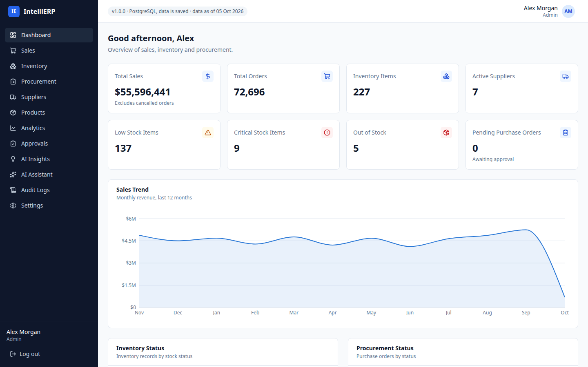
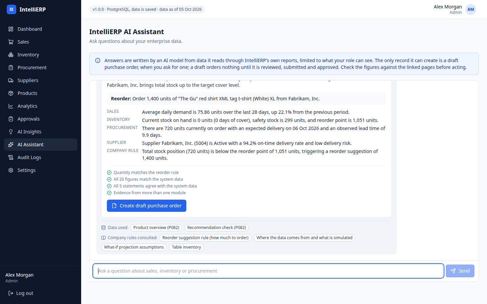
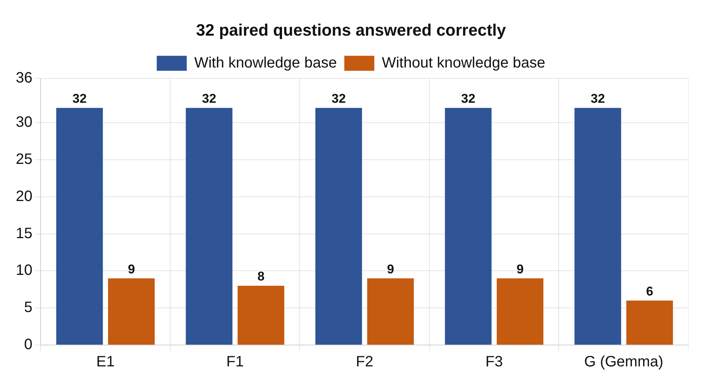
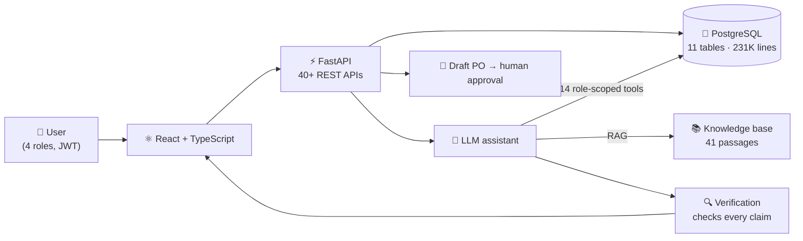
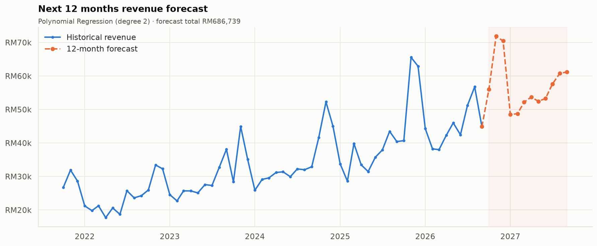
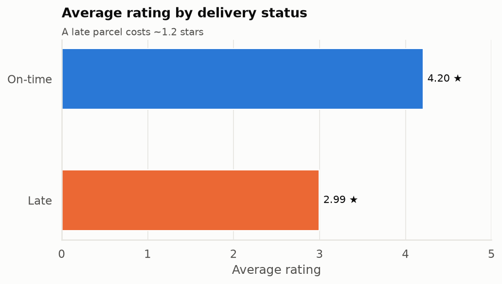
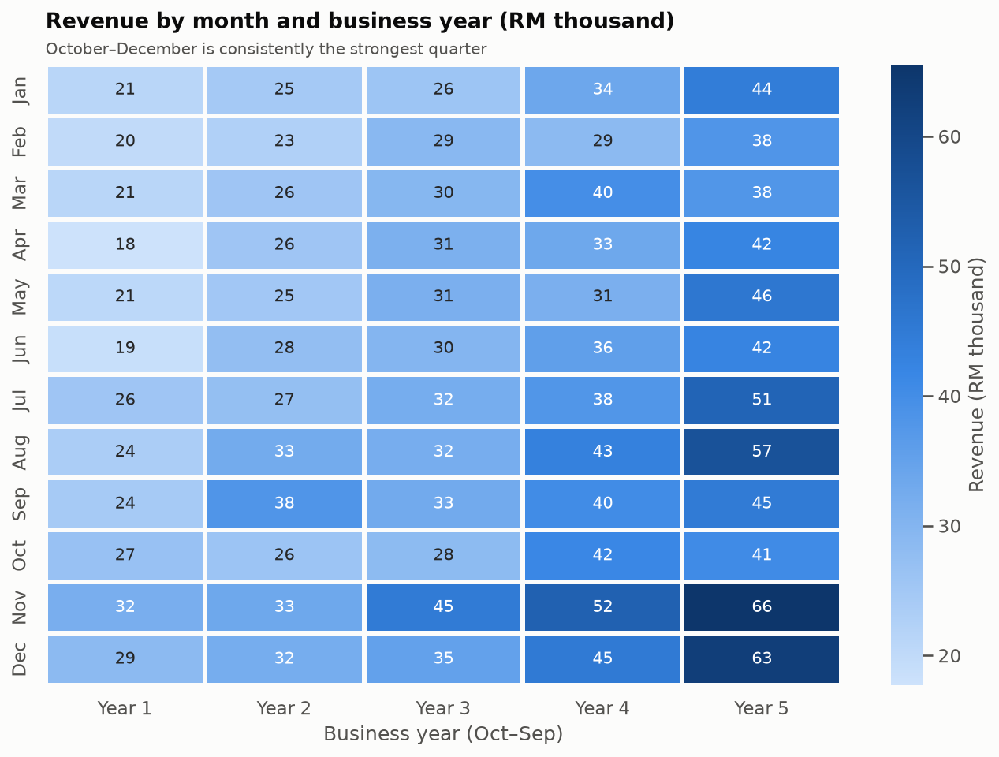
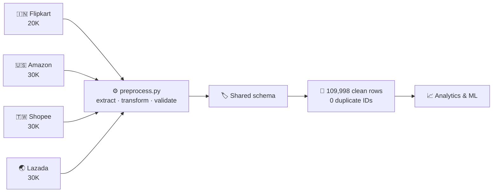
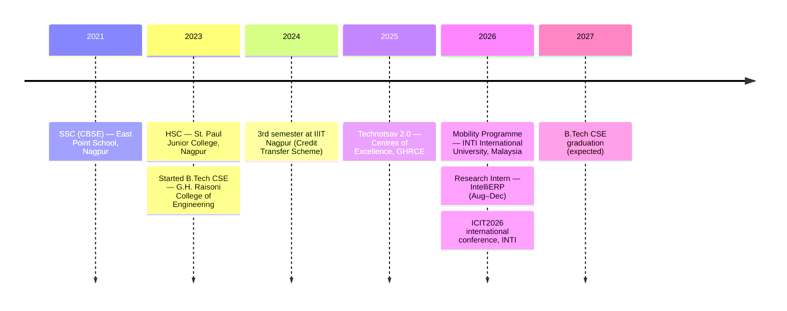

<!-- Profile README · github.com/MYSiddique2005 -->

<div align="center">


<a href="https://github.com/MYSiddique2005"></a>

<p>
  <a href="https://www.linkedin.com/in/mohammad-yasin-siddique-085b1b316/"></a>
  <a href="mailto:my.siddique2005@gmail.com"></a>
  <a href="https://mysiddique2005.github.io/Byte-Supply-E-Commerce-Business-Analytics/"></a>
</p>
<p>
  
  
  
</p>

<sub>
<a href="#about">About</a> ·
<a href="#impact">Impact</a> ·
<a href="#internship">Internship</a> ·
<a href="#projects">Projects</a> ·
<a href="#skills">Skills</a> ·
<a href="#journey">Journey</a> ·
<a href="#activity">Activity</a> ·
<a href="#connect">Connect</a>
</sub>

</div>

---

<a id="about"></a>
## 👋 About me

Final-year **Computer Science Engineering** student with hands-on experience building end-to-end
**analytics, ERP and machine learning** solutions using **Python and SQL** on datasets of **230,000+ records**.
I'm looking for a **Data Analyst** role to turn business data into actionable insights and support data-driven decisions.

```python
yasin = {
    "role":      "Data Analyst | AI & Business Analytics",
    "education": "B.Tech CSE @ G.H. Raisoni College of Engineering, Nagpur (2027)",
    "now":       ["Research Intern @ INTI International University", "7th-semester Mobility Programme, Malaysia"],
    "focus":     ["EDA", "Data Cleaning", "ETL", "KPI Analysis", "Regression", "Forecasting", "LLM Integration", "RAG"],
    "stack":     ["Python", "SQL", "pandas", "NumPy", "scikit-learn", "FastAPI", "PostgreSQL", "React"],
}
```

<a id="impact"></a>
## 📈 Impact in numbers


---

<a id="internship"></a>
## 💼 Internship

> Click ▶ under any project to expand screenshots, charts and architecture.

### 🧠 [IntelliERP](https://github.com/MYSiddique2005/IntelliERP) — LLM-Grounded Intelligent ERP Decision Support
<sub>**Research Internship · INTI International University · Aug – Dec 2026**</sub>


- **Enterprise data integration** — 5-module ERP (Sales, Inventory, Procurement, Products, Suppliers) with **40+ REST APIs** and **11 PostgreSQL tables**, loaded with **231,412** sales order lines and **227** products
- **AI & business intelligence** — LLM assistant grounded in a **41-passage** knowledge base with **14 role-scoped tools** for **stockout risk, demand forecasting and supplier KPIs**, raising test accuracy from **28% → 100%**
- **Workflow automation** — JWT authentication, **role-based access control for 4 roles**, audit logging and a purchase-order approval workflow with human sign-off; **98–100%** across 3 runs of an 86-question evaluation

<details>
<summary><b>🖼️ Show screenshots &amp; architecture</b></summary>
<br>

| ERP dashboard | AI assistant with evidence |
|:-:|:-:|
|  |  |





</details>

---

<a id="projects"></a>
## 🚀 Projects

### 📊 [Byte Supply — E-Commerce Business Analytics](https://github.com/MYSiddique2005/Byte-Supply-E-Commerce-Business-Analytics)
<sub>**Individual project · Oct 2026** · [🌐 Live interactive dashboard](https://mysiddique2005.github.io/Byte-Supply-E-Commerce-Business-Analytics/)</sub>


- **Exploratory data analysis** — analysed **24,991** transactions (**RM 2.04M** revenue over 5 years): **36.5%** gross margin, **89.6%** on-time delivery; mega-sale days earned **25.1%** margin vs **36.8%** otherwise
- **Predictive modelling** — linear vs polynomial regression on a chronological 80/20 split; polynomial model cut **MAE by 21.5%** and raised **R² from 0.15 to 0.54** for a 12-month revenue forecast
- **Data visualisation** — 10 Seaborn and Matplotlib charts showing late deliveries cut average rating from **4.20 to 2.99** and that **Q4 generates 29.2%** of annual revenue

<details>
<summary><b>📉 Show charts</b></summary>
<br>



| Late-delivery impact on ratings | Seasonality heatmap |
|:-:|:-:|
|  |  |

</details>

---

### 🛒 [Supply Chain Big Data Analytics](https://github.com/MYSiddique2005/SupplyChain-BigDataAnalytics)
<sub>**Team project (5 members) · Sep – Oct 2026**</sub>


- **Data acquisition** — processed **~110,000** product records from **Amazon, Flipkart, Shopee and Lazada** for multi-platform e-commerce dataset preparation
- **ETL & data quality** — extraction, transformation, schema standardisation, deduplication, missing-value assessment and validation across heterogeneous CSV datasets
- **Team collaboration** — coordinated preprocessing, quality checks and documentation within a five-member team, applying communication, problem-solving and analytical thinking

<details>
<summary><b>🔧 Show the ETL pipeline</b></summary>
<br>



</details>

---

<a id="skills"></a>
## 🛠️ Technical skills

<p align="center">
  
</p>

<table>
<tr><td><b>Languages</b></td><td>


</td></tr>
<tr><td><b>Data Analysis &amp; ML</b></td><td>


</td></tr>
<tr><td><b>Backend &amp; Databases</b></td><td>


</td></tr>
<tr><td><b>Concepts</b></td><td>

`EDA` · `Data Cleaning` · `Data Preprocessing` · `ETL` · `Statistical Analysis` · `Regression` · `Forecasting` · `KPI Analysis` · `Data Visualization` · `LLM Integration` · `RAG`

</td></tr>
</table>

---

<a id="journey"></a>
## 🧭 Journey



<details>
<summary><b>🎓 Education details</b></summary>
<br>

| Programme | Institution | Year |
|---|---|:-:|
| **B.Tech, Computer Science Engineering** | G.H. Raisoni College of Engineering, Nagpur | 2027 (expected) |
| 7th Semester Mobility Programme | INTI International University, Malaysia | 2026 |
| 3rd Semester, Credit Transfer Scheme | IIIT Nagpur | — |
| Higher Secondary Certificate (HSC) | St. Paul Junior College, Nagpur | 2023 |
| Secondary School Certificate (SSC, CBSE) | East Point School, Nagpur | 2021 |

</details>

<details>
<summary><b>🏅 Events &amp; conferences</b></summary>
<br>

- **ICIT2026** — 9th International Conference on Innovation and Technopreneurship, INTI International University, Malaysia (10 Sep 2026)
- **Technotsav 2.0** — technical festival by the Centres of Excellence, G.H. Raisoni College of Engineering, Nagpur (21–22 Mar 2025)

</details>

---

<a id="activity"></a>
## 📊 GitHub activity

<div align="center">


</div>

---

<div align="center">

<a id="connect"></a>
### 🤝 Let's connect

Open to **Data Analyst** and **Business / AI Analytics** opportunities.

<a href="https://www.linkedin.com/in/mohammad-yasin-siddique-085b1b316/"></a>
<a href="mailto:my.siddique2005@gmail.com"></a>

</div>
